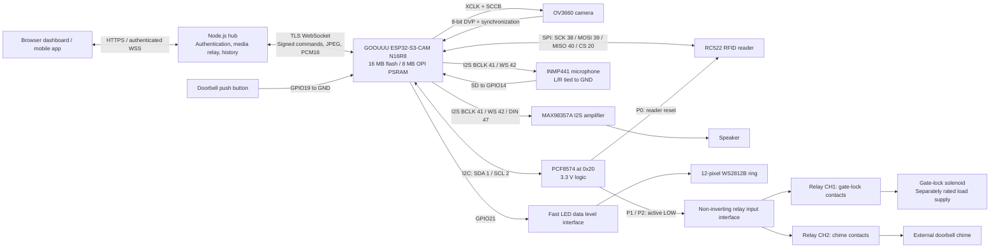

# Smart Camera Bell

## 1. 🚀 Project Overview & Features

Smart Camera Bell is a modular IoT entrance controller built around the **GOOUUU Tech ESP32-S3-CAM N16R8**, an **OV3660 camera**, and a C++ firmware application using **PlatformIO and Arduino-ESP32**. It combines video capture, simultaneous microphone/speaker audio, offline RFID authorization, visual feedback, and bounded actuator control. A Node.js/WebSocket hub connects the edge device to the companion browser dashboard and mobile application.

The architecture separates local access and relay timing from remote media and administration. Enrolled, permitted cards can authorize access without the hub or internet. Physical button/chime handling runs independently of the main networking loop. Remote operations require the authenticated hub connection; protected administrative actions additionally require the owner PIN.

### Hardware-driven capabilities

- **Video streaming:** OV3660 JPEG capture with PSRAM-backed framebuffers. The current implementation uses VGA for normal snapshots and QVGA during intercom sessions, with a maximum video scheduling target of approximately two frames per second to prioritize speech. Actual throughput depends on network conditions.
- **Full-duplex I2S intercom:** simultaneous INMP441 microphone capture and MAX98357A I2S DAC/class-D amplifier playback. The network voice format is mono PCM16 at 16 kHz; the hardware uses shared clocks and separate receive/transmit data lines.
- **Protected offline RFID authentication:** RC522/MFRC522 sector authentication with independently provisioned keys, a random credential, and a UID-bound marker. UID matching alone is insufficient. Supported provisioning targets MIFARE Classic 1K tags with four-byte UIDs and the documented initial sector state.
- **Immediate local control path:** a physical button requests the external chime without a cloud round trip. Current debounce is 150 ms; a dedicated relay task runs at approximately 5 ms intervals. These are software parameters, not a guarantee of instantaneous mechanical actuation.
- **Bounded relay triggers:** the two-channel relay module controls the external chime and gate-lock solenoid. Lock pulses are capped at 1,000 ms, repeated requests cannot extend a pulse, and a two-second cooldown follows expiry. Continuous chime activation is limited to 30 seconds.
- **Status and night lighting:** a 12-pixel WS2812B RGB ring provides a dim idle animation, access feedback, alarm signaling, and porch illumination.
- **Persistent device preferences:** idle/active LED brightness and incoming speech gain are stored on the ESP32. Browser appearance, time display, and receive volume are configured separately.
- **Operational dashboard:** Live view, Activity, Cards, Settings, and Diagnostics; light/dark themes; searchable paginated history; protected snapshots; CSV export; and downloadable diagnostics.
- **Authenticated command transport:** TLS certificate verification, exact-payload HMAC-SHA256 signatures, boot-session binding, and sequence/nonce-based replay checks. The hub waits for device acknowledgement instead of assuming successful delivery.

### Repository profile and implementation status

The approximate language profile is **50% JavaScript**, **32% C++**, with the remainder primarily **CSS and HTML**. JavaScript implements the companion dashboard/application and hub; C++ implements the firmware core. These proportions describe the project profile, not a measured guarantee of the current GitHub Linguist output.

The documented firmware baseline is **3.1.0-rc6**. Firmware build, upload, startup, and automated web/API checks have been exercised; the owner has reported working camera streaming, simultaneous intercom operation, and enrolled-card access. Environmental, EMC, thermal, and mechanical qualification remain outstanding. Deployment and verification details are recorded in [RC6_DEPLOYMENT.md](RC6_DEPLOYMENT.md).

## 2. 📐 Hardware Architecture & Schematics

### Functional interconnect



This is a functional interconnect, not a relay-contact wiring schematic. **RC522 SPI signals connect directly to the ESP32.** The PCF8574 saves GPIOs by handling reader reset and the two relay controls; it does not transport SPI. The button remains a direct GPIO input.

### Conflict-free GPIO allocation

The authoritative definitions are in [pins.h](firmware/esp32_cam_doorbell/include/pins.h). This allocation preserves the working GOOUUU/OV3660 camera wiring.

| Peripheral | Signal | ESP32-S3 GPIO | Connection / constraint |
|---|---|---:|---|
| PCF8574 | I2C SDA | 1 | Pull up to 3.3 V |
| PCF8574 | I2C SCL | 2 | Pull up to 3.3 V |
| OV3660 | SCCB SDA | 4 | Separate from the PCF8574 I2C bus |
| OV3660 | SCCB SCL | 5 | Camera control clock |
| OV3660 | VSYNC | 6 | Frame synchronization |
| OV3660 | HREF | 7 | Line-valid signal |
| OV3660 | D2 | 8 | Parallel camera data |
| OV3660 | D1 | 9 | Parallel camera data |
| OV3660 | D3 | 10 | Parallel camera data |
| OV3660 | D0 | 11 | Parallel camera data |
| OV3660 | D4 | 12 | Parallel camera data |
| OV3660 | PCLK | 13 | Pixel clock |
| INMP441 | SD | 14 | Microphone output to ESP32 input |
| OV3660 | XCLK | 15 | 20 MHz camera clock |
| OV3660 | D7 | 16 | Parallel camera data |
| OV3660 | D6 | 17 | Parallel camera data |
| OV3660 | D5 | 18 | Parallel camera data |
| Doorbell button | Input | 19 | Normally open switch to GND; `INPUT_PULLUP` |
| RC522 | SS / CS | 20 | Often labeled SDA on the reader; used as SPI CS |
| WS2812B ring | DIN | 21 | Through a suitable fast logic-level interface |
| RC522 | SCK | 38 | Direct ESP32 SPI clock |
| RC522 | MOSI | 39 | ESP32 output to reader |
| RC522 | MISO | 40 | Reader output to ESP32 |
| INMP441 + MAX98357A | BCLK | 41 | Shared I2S bit clock |
| INMP441 + MAX98357A | WS / LRC | 42 | Shared I2S word-select clock |
| MAX98357A | DIN | 47 | ESP32 audio output to amplifier |

| Additional allocation | Assignment | Requirement |
|---|---|---|
| OV3660 PWDN / RESET | `-1` / `-1` in firmware | No dedicated software-controlled GPIO in this configuration |
| PCF8574 P0 | RC522 RST | 3.3 V logic; P0 is not ESP32 GPIO0 |
| PCF8574 P1 | Gate-lock relay CH1 | Logical LOW energizes; HIGH releases |
| PCF8574 P2 | Chime relay CH2 | Logical LOW energizes; HIGH releases |
| PCF8574 P3–P7 | Unassigned | Not exposed as configurable application I/O |
| PCF8574 A0–A2 | GND | Address `0x20` on the specified PCF8574 variant |
| INMP441 L/R | GND | Selects the left I2S slot |
| UART0 | GPIO43 / GPIO44 | Preserve for USB-to-UART programming/diagnostics |
| Onboard LED | GPIO48 | Reserved; not driven by this firmware |

The microphone channel selection follows the [INMP441 datasheet](https://invensense.tdk.com/wp-content/uploads/2015/02/INMP441.pdf): L/R LOW selects the left I2S slot.

GPIO19/20 are occupied, so **native USB/OTG and USB Serial/JTAG are unavailable with this wiring**. Program through the board's USB-to-UART port. Do not repurpose flash/PSRAM signals: GPIO26–32 are generally memory-related, and GPIO33–37 are also used in Octal-memory configurations. GPIO0, GPIO3, GPIO45, and GPIO46 require strapping-pin analysis before future reassignment. See [Espressif's GPIO restrictions](https://docs.espressif.com/projects/esp-idf/en/stable/esp32s3/api-reference/peripherals/gpio.html).

### Electrical and actuator domains

- Supply the RC522, INMP441, PCF8574 logic, and ESP32-side pull-ups at **3.3 V**. No 5 V pull-up or signal may drive an ESP32 GPIO or RC522 reset.
- The confirmed relay module uses a **5 V module/coil supply**. Input thresholds/current must be verified separately. Use an interface preserving active-LOW polarity; an arbitrary inverting transistor stage changes the required logic.
- The PCF8574 is a quasi-bidirectional signal expander, not a coil/solenoid driver. Outputs power up HIGH, but drive characteristics still require interface validation. Refer to the [TI PCF8574 datasheet](https://www.ti.com/lit/ds/symlink/pcf8574.pdf).
- Power the amplifier and LED ring according to their module ratings. Budget LED, amplifier, and relay current independently of the ESP32 USB supply. Provide local bypass/bulk capacitance and controlled return paths.
- The MAX98357A speaker output is differential. Connect the speaker across the specified output terminals, not between one output and logic ground. See the [amplifier output wiring guidance](https://learn.adafruit.com/adafruit-max98357-i2s-class-d-mono-amp/pinouts).
- Relay contacts switch a separately fused load supply. A 5 V relay module does not establish solenoid/chime operating voltage. Select contact ratings, NO/NC behavior, suppression, and wiring from the actual loads.

DC inductive loads require appropriately rated flyback/TVS suppression with the required release behavior; AC loads need a different suppression design. See [WIRING_AND_SETUP_GUIDE.md](firmware/WIRING_AND_SETUP_GUIDE.md) for detailed wiring constraints.

## 3. 🛠 PlatformIO Setup & Installation Guide

### Prerequisites and project setup

1. Install **Visual Studio Code with PlatformIO IDE**, or install **PlatformIO Core** using its [official installation procedure](https://docs.platformio.org/en/latest/core/installation/methods/installer-script.html).
2. Install the USB-to-UART driver required by the board and identify its serial port. The verified Windows port was `COM9`; substitute the port assigned on the target machine.
3. Install **Node.js 22.12 or later**, compatible with the repository package requirements, for the hub/dashboard.
4. Disconnect lock/chime contact loads for initial commissioning. Verify voltage interfaces and relay polarity before applying actuator power.

```sh
git clone https://github.com/ggopgg/smart-bell-app.git
cd smart-bell-app
```

In PlatformIO IDE, open `firmware/esp32_cam_doorbell`. The supported entry point is `src/main.cpp`; the archived `.ino` is not the deployment build.

### PlatformIO configuration

The platform identifier is **`espressif32`**; **`esp32s3`** is the MCU target. The generic board manifest describes an N8/no-PSRAM development board, so explicit N16R8 memory overrides are required. Its displayed description is not a measurement of the installed module. See the [PlatformIO board documentation](https://docs.platformio.org/en/latest/boards/espressif32/esp32-s3-devkitc-1.html).

The following matches the pinned project environment:

```ini
[platformio]
default_envs = esp32s3_doorbell
src_dir = src
include_dir = include

[env:esp32s3_doorbell]
platform = espressif32 @ 6.13.0
board = esp32-s3-devkitc-1
framework = arduino

monitor_speed = 115200
upload_speed = 460800
monitor_filters = esp32_exception_decoder, time, default

board_build.mcu = esp32s3
board_build.f_cpu = 240000000L
board_build.f_flash = 80000000L
board_build.flash_mode = qio
board_build.arduino.memory_type = qio_opi
board_build.psram_type = opi
board_upload.flash_size = 16MB
board_build.flash_size = 16MB

board_build.partitions = partitions.csv
board_build.filesystem = littlefs

build_flags =
    -DBOARD_HAS_PSRAM
    -DCORE_DEBUG_LEVEL=3
    -I include

lib_deps =
    links2004/WebSockets @ 2.7.3
    miguelbalboa/MFRC522 @ 1.4.12
    adafruit/Adafruit NeoPixel @ 1.15.5
    bblanchon/ArduinoJson @ 7.4.3
```

`qio_opi` selects the Quad-flash/Octal-PSRAM build configuration. The physical target must provide **16 MB flash and 8 MB OPI PSRAM**; camera initialization refuses to proceed without PSRAM.

**PCF8574 support uses the framework's `Wire` library**, with one task owning expander writes. No external PCF8574 library is required or currently declared. A second library independently writing the port can overwrite relay/reset bits and violate output ownership. SPI, Preferences, LittleFS, camera support, and I2S drivers come from the framework packages.

The [partition table](firmware/esp32_cam_doorbell/partitions.csv) reserves 20 KiB NVS, 8 KiB OTA metadata, two 5 MiB application slots, 5.875 MiB LittleFS, and 64 KiB coredump storage. Reserved application slots do not constitute an implemented authenticated OTA service.

### Configure private settings

Create local configuration files from the repository root. PowerShell example:

```powershell
Copy-Item .env.example .env
Copy-Item firmware/esp32_cam_doorbell/include/secrets.h.example firmware/esp32_cam_doorbell/include/secrets.h
```

| Setting | Location | Purpose |
|---|---|---|
| `WIFI_SSID`, `WIFI_PASSWORD` | Firmware `secrets.h` | Wi-Fi association |
| `BACKEND_HOST`, `BACKEND_PORT`, `BACKEND_USE_SSL` | Firmware `secrets.h` | Hub hostname, port, and TLS selection |
| `BACKEND_ROOT_CA` | Firmware `secrets.h` | Trusted root CA for the hub certificate chain |
| `DEVICE_HMAC_KEY` | Hub environment and firmware | Identical signing key at both endpoints |
| `DEVICE_CONNECTION_TOKEN` | Hub environment and firmware | Identical device connection credential |
| `MOBILE_WS_TOKEN` | Hub environment; entered in app | Private dashboard/application access token |
| `OWNER_USERNAME`, `OWNER_PIN` | Hub environment | Owner authorization; PIN contains 6–12 digits |
| `DATA_DIR` | Hub environment | Persistent history, captures, and notification storage |

Generate independent random secrets instead of reusing example strings:

```sh
node -e "console.log(require('crypto').randomBytes(32).toString('hex'))"
```

For production, configure the correct hostname, TLS port, and trusted CA. An empty CA configuration refuses TLS; do not bypass certificate verification. Keep `.env` and `secrets.h` out of Git. Firmware binaries embed deployment credentials and must not be published as generic public artifacts.

### Build, flash, and monitor

Run from the repository root:

```sh
# Resolve dependencies, compile, link, and generate the image.
pio run -d firmware/esp32_cam_doorbell -e esp32s3_doorbell

# Build and flash through USB-to-UART.
pio run -d firmware/esp32_cam_doorbell -e esp32s3_doorbell -t upload --upload-port COM9

# Read startup and diagnostics.
pio device monitor --port COM9 --baud 115200
```

Close Serial Monitor before uploading. Verify PSRAM initialization, LittleFS mounting, OV3660 identification, RC522 communication, Wi-Fi association, and backend connection in the startup log.

**First-install filesystem provisioning only:** if no valid LittleFS filesystem exists and there is no card metadata, history, or snapshot data to preserve, initialize it using:

```sh
pio run -d firmware/esp32_cam_doorbell -e esp32s3_doorbell -t uploadfs --upload-port COM9
```

**Do not run `uploadfs` as a routine firmware-update step:** it replaces filesystem contents. Do not erase the full chip/NVS on an enrolled device; private card keys and enrollment recovery records reside in NVS. Filesystem replacement can remove metadata needed to authorize a provisioned card. Mount failures deliberately do not trigger automatic formatting.

### Start the hub and dashboard

After configuring `.env`:

```sh
npm ci
npm test
npm run build
npm start
```

The default hub port is `3000`, unless `PORT` is set. The server serves `dist/`; the web build copies the production dashboard from `public/`. Deploy with HTTPS/WSS and persistent storage for `DATA_DIR`. Browser microphone access requires a secure context.

Enter the private app token in the connection form. Tokens remain in tab memory; protected actions require the owner PIN. An acknowledged unlock means a bounded pulse was accepted, not that the gate physically opened. A timed-out action may already have occurred; inspect state before retrying.

### Provision offline RFID access

1. Pause card access through the owner-confirmed app control or `RFID DISABLE` in Serial Monitor.
2. Arm `RFID ENROLL` followed by the intended tag's eight hexadecimal UID characters. Present only that compatible tag and keep it still until `RESULT=READY`.
3. Remove the tag; repeat independently for additional project tags.
4. Enable access only after enrollment succeeds. Adding a UID through the dashboard does not provision private sector keys.
5. Verify permitted access, revocation, restart persistence, and offline operation while maintaining an alternative means of entry.

Enrollment programs sector 15, blocks 60–63, and changes its keys. It does not write manufacturer block 0. Interrupted enrollment must be retried with the same recovery records intact. Disabled/unknown scans can contribute to the alarm threshold; remove a tag after enrollment rather than repeatedly testing it while access is paused.

The supported initial tag state and complete recovery workflow are documented in [OFFLINE_CARD_ENROLLMENT_RC5.md](OFFLINE_CARD_ENROLLMENT_RC5.md). Follow [RC6_DEPLOYMENT.md](RC6_DEPLOYMENT.md) for the dashboard update procedure.

## 4. ⚠️ Technical Flaws & Constraints

### GPIO utilization and expander dependency

Camera, audio, SPI, button, and LED connections consume most practical board GPIOs. The PCF8574 preserves native pins for timing-sensitive interfaces but introduces a shared I2C dependency for both relays and reader reset. Its quasi-bidirectional outputs are not push-pull power drivers. An I2C acknowledgement does not measure relay contact position.

Firmware initializes expander outputs HIGH and uses active-LOW relay inputs. If the expander remains powered during an MCU reset, a previously latched output can persist until initialization reaches it. Bus faults, a stalled processor, incorrect interface polarity, or welded contacts cannot be made safe by a software timeout alone. A pulse-rated solenoid requires an independent hardware maximum-on cutoff and appropriate overcurrent protection.

### Thermal management

Wi-Fi transmission, camera clocks, PSRAM traffic, TLS, and continuous I2S processing impose sustained load. Amplifier, LED, and regulator losses can further heat a compact enclosure. Measure thermal behavior on the assembled unit at the intended ambient temperature and duty cycle; no qualified enclosure temperature rise or continuous-duty limit is established here.

Provide an enclosure-appropriate thermal path, separate heat sources from the camera/radio where practical, and preserve antenna keep-out. Validate hot-start behavior, rail droop, audio continuity, and camera stability during prolonged simultaneous use. Ending a live session does not deinitialize the camera or guarantee minimum power consumption.

### SPI/I2C integrity near inductive loads

Solenoid and relay switching can produce conducted transients, ground bounce, and radiated interference. Breadboard jumpers increase loop area and parasitic coupling. Faults may appear as RC522 authentication failures, missing I2C acknowledgements, audio corruption, camera errors, or MCU resets.

Keep buses short, separate actuator conductors from signal paths, maintain low-impedance reference paths, and place suppression at the inductive load. High-current returns must not flow through microphone, camera, or MCU reference paths. Measure I2C rise time and logic margins instead of assuming extra pull-ups or a generic level-shifter board will resolve noise.

### Security, storage, and media limits

- **Legacy tag cryptography:** protected per-tag credentials improve on UID-only access but do not repair MIFARE Classic Crypto1. See the [MFRC522 library security guidance](https://github.com/miguelbalboa/rfid#security). Ordinary NVS is not a secure element; secure boot and flash encryption are not provisioned by this firmware.
- **Failed revocation persistence:** a failed disable/revocation is not confirmed durable. Relevant failure paths block runtime authorization, but a rejected storage write can leave an older state available after restart. Resolve the storage failure and obtain confirmation before relying on offline revocation.
- **No ESP-side acoustic echo cancellation:** full duplex means concurrent transport, not removal of speaker-to-microphone coupling. Mechanical separation, gain tuning, and acoustic design remain necessary. Browser echo cancellation is not an ESP-side AEC implementation.
- **Bandwidth and scheduling:** JPEG images and uncompressed PCM travel over WebSocket/TLS, not WebRTC or H.264. Each 16 kHz PCM16 audio direction carries 32 kB/s before protocol overhead. Congestion can reduce frame rate or interrupt speech. One live media viewer is supported at a time.
- **Finite persistence:** the offline queue is bounded; history/snapshot retention needs an operational policy. Uptime-only timestamps are not wall-clock audit records. The card database supports at most 100 metadata records; unreadable or incomplete baselines are refused for snapshots.
- **Unverified actuator rating:** the relay module's 5 V supply is known; the lock's voltage, current, duty cycle, release behavior, and contact requirements must be established separately. The proposed 12 V revision below does not establish the installed lock's rating.

## 5. 🗺 Roadmap & Future Improvements

These items are planned engineering work, not current capabilities.

| Priority | Improvement | Implementation scope and acceptance criteria |
|---|---|---|
| P0 | **Custom multilayer PCB** | Replace perfboard/breadboard wiring with a continuous reference plane, short camera/SPI/I2S paths, and segregated actuator power routing. Preserve antenna keep-out and add test points. Validate transients and bus integrity during repeated solenoid switching with video and full-duplex audio active. |
| P0 | **Independent actuator protection** | Add a hardware pulse cutoff, appropriate relay/MOSFET drivers, fused branches, and load-specific suppression. Test reset, bus-disconnect, brownout, and stuck-control behavior independently of firmware. Add gate/lock feedback where physical state confirmation is required. |
| P0 | **Single-input power delivery** | For a confirmed **12 V DC lock**, evaluate one protected 12 V adapter supplying the actuator branch and dedicated buck conversion for clean 5 V/3.3 V rails. Size for inrush, relays, LEDs, Wi-Fi peaks, and amplifier demand. Measure ripple and transient recovery at the MCU and microphone. |
| P1 | **Local Edge AI using ESP-WHO** | Prototype face detection, then separately evaluate recognition. Port GOOUUU/OV3660 board support and budget PSRAM, internal SRAM, inference latency, and concurrent media load. Upstream [ESP-WHO](https://github.com/espressif/esp-who) uses supported ESP-IDF releases/board support; it is not a drop-in library for the pinned Arduino build. Recognition must not directly authorize a gate without an independent spoofing/authorization design. |
| P1 | **Audio and thermal qualification** | Benchmark ESP-side AEC using the actual playback reference. Improve microphone/speaker isolation; measure intelligibility, clipping, dropouts, and temperature rise during continuous operation. |
| P1 | **Authenticated lifecycle updates** | Design signed firmware delivery, rollback/recovery, and configuration migration. Evaluate secure boot and flash encryption separately before irreversible eFuse provisioning. |
| P2 | **Mechanical and operational hardening** | Publish enclosure CAD, sealing/drainage details, connector retention, and service access. Add retention policies and repeatable environmental/EMI test procedures. |

## 6. 📁 Repository Tree

Current source layout:

```text
smart-bell-app/
├── README.md
├── START_HERE.md                         # Integrated setup and commissioning
├── RC6_DEPLOYMENT.md                     # Dashboard/firmware release procedure
├── OFFLINE_CARD_ENROLLMENT_RC5.md         # Protected-tag enrollment and recovery
├── PROTOCOL_AND_TESTING.md               # Protocol background and validation limits
├── DASHBOARD_UPDATE.md                   # Dashboard behavior contract
├── PRODUCT.md                           # Product requirements and constraints
├── DESIGN.md                            # Dashboard design decisions
├── .env.example                         # Hub environment template
├── .gitignore
├── package.json
├── package-lock.json
├── server.js                            # HTTP/WebSocket hub and signed commands
├── dashboard-support.js                 # Settings/card/telemetry validation
├── push-service.js                      # Companion notification service
├── public/                              # Production doorbell dashboard
│   ├── doorbell.html
│   ├── doorbell.css
│   ├── doorbell.js
│   ├── dashboard-data.js
│   ├── pcm-worklet.js                    # Browser microphone processing
│   └── playback-worklet.js               # Buffered visitor-audio playback
├── index.html                           # Legacy simulator entry
├── src/                                 # Browser/simulator code; not firmware
│   ├── js/
│   └── css/
├── mobile-app/                          # Companion application
│   ├── App.js
│   ├── src/
│   ├── assets/
│   ├── app.json
│   └── package.json
├── firmware/
│   ├── WIRING_AND_SETUP_GUIDE.md          # Current wiring reference
│   ├── home_assistant_config.yaml
│   └── esp32_cam_doorbell/
│       ├── platformio.ini
│       ├── partitions.csv
│       ├── include/
│       │   ├── pins.h
│       │   ├── config.h
│       │   ├── secrets.h.example
│       │   ├── classic_credentials.h
│       │   ├── credential_preferences.h
│       │   ├── device_settings.h
│       │   ├── audio_processing.h
│       │   └── relay_policy.h
│       ├── src/
│       │   ├── main.cpp
│       │   ├── api_client.cpp
│       │   ├── camera_manager.cpp
│       │   ├── audio_manager.cpp
│       │   ├── nfc_manager.cpp
│       │   ├── relay_manager.cpp
│       │   ├── led_manager.cpp
│       │   ├── storage_manager.cpp
│       │   └── ...                      # Headers and additional managers
│       ├── data/
│       │   └── README.txt               # Initial LittleFS image content
│       └── esp32_cam_doorbell.ino        # Archived sketch; not the build entry
├── tests/                               # Web/API, audio, RFID, and policy tests
└── validation/                          # Dependency/validation records
```

`dist/` is generated by the web build; PlatformIO downloads dependencies into its generated `.pio/` tree. Runtime hub data belongs in `DATA_DIR`. Private `.env`, firmware `include/secrets.h`, build caches, and runtime captures are not source configuration to publish.

No project-local firmware `lib/`, enclosure CAD directory, detailed circuit schematic, or PCB layout is currently tracked. The wiring guide and functional diagram are the present hardware references. Reserve this layout when those artifacts are produced:

```text
planned additions — not present in the current tree
├── firmware/esp32_cam_doorbell/lib/      # Reusable project-local C++ libraries
├── hardware/
│   ├── schematics/                      # Editable schematics and exported PDFs
│   ├── pcb/                             # Board sources and fabrication files
│   └── bom/                             # Rated parts and assembly data
└── mechanical/
    └── enclosure/                       # Editable CAD, STEP, STL, mounting drawings
```
